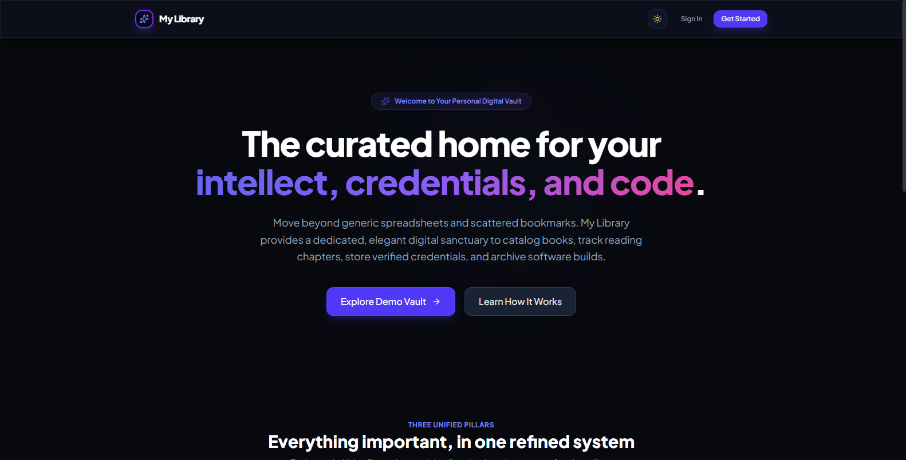
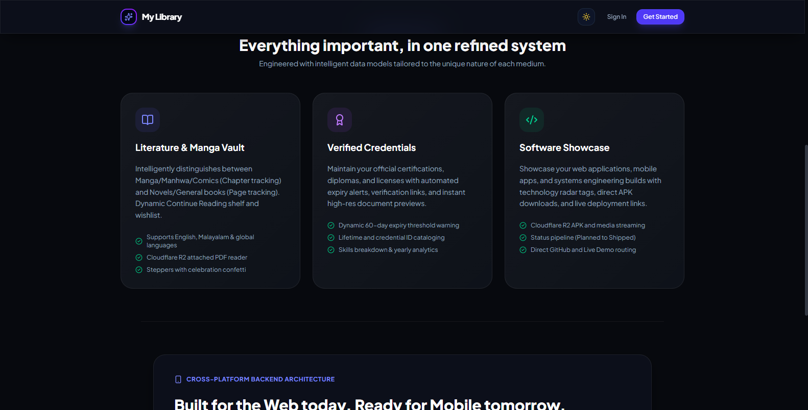

# 📚 My Library — Personal Digital Collection & Developer Vault

<div align="center">

[](https://react.dev/)
[](https://tailwindcss.com/)
[](https://vitejs.dev/)
[](https://www.typescriptlang.org/)
[](LICENSE)

An elegant, all-in-one personal digital sanctuary for cataloging books and manga, tracking reading chapters, storing verified credentials, and archiving software builds.

<br/>



</div>

---

## 📸 Previews

| Personal Digital Vault | Three Unified Pillars |
| :---: | :---: |
|  |  |
| **Hero & Reading Sanctuary** | **Literature, Credentials & Software** |

---

## ✨ Features

- 📖 **Literature & Manga Vault**: Intelligently tracks manga/manhwa chapter progress and novel page counts with confetti celebrations.
- 🎖️ **Verified Credentials Archive**: Store official diplomas, certifications, and licenses with expiry threshold warnings.
- 💻 **Software Showcase**: Portfolio hub for web applications, mobile APKs, and live production deployment links.
- 📊 **Reading Analytics**: Visualizes reading trends, completed books, and weekly milestones.
- 🌓 **Adaptive Light/Dark Theme**: Clean aesthetics with fluid transitions powered by Tailwind CSS.

---

## 🚀 How to Run

1. **Install Dependencies**:
   ```bash
   npm install
   ```
2. **Start Dev Server**:
   ```bash
   npm run dev
   ```
   Then navigate to [`http://localhost:5173`](http://localhost:5173).
3. **Build for Production**:
   ```bash
   npm run build
   ```

---

## 📄 License

MIT License © 2026 [Sooraj Studio](https://github.com/soorajstudio)
